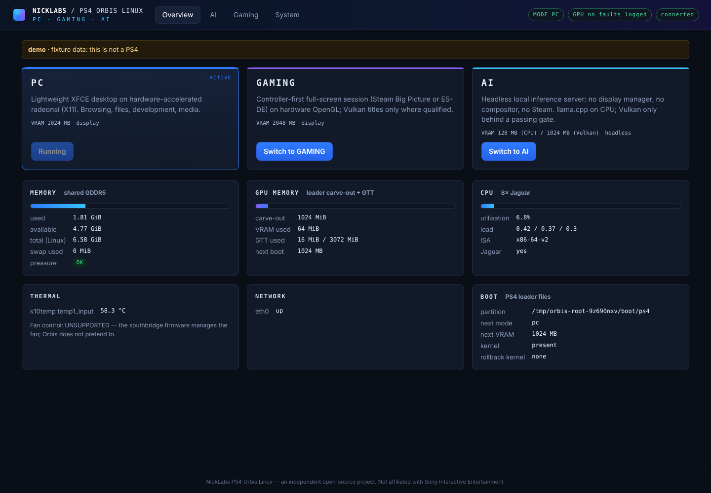

# NICKLABS / PS4 ORBIS LINUX — PC · GAMING · AI

One Linux installation for the PlayStation 4, with three personalities you can switch between:

- **PC** — a lightweight XFCE desktop on hardware-accelerated radeonsi.
- **GAMING** — a controller-first session (Steam Big Picture / ES-DE) for games that actually run.
- **AI** — a headless llama.cpp server on your LAN. It runs on the CPU by default; Vulkan offload is admitted only after it proves itself on your exact stack.

> **Status: 0.2.0, installable release pipeline — not hardware-qualified.**
> - Target: CUH-1215A (fat, Belize), FW 13.50, GoldHEN, LAN only.
> - A stage-0 hardware-report image (kernel + initramfs + verified firmware) is built and checked.
> - The full PC · GAMING · AI image builds with one command on Nobara: [docs/INSTALL-NOBARA.md](docs/INSTALL-NOBARA.md).
> - Nothing has been booted on a PS4 by Orbis yet. See [docs/RELEASE-STATUS.md](docs/RELEASE-STATUS.md) and [docs/HARDWARE-QUALIFICATION.md](docs/HARDWARE-QUALIFICATION.md).



## What Orbis adds to the PS4 Linux ecosystem

- **Mode engine** (`orbis mode pc|gaming|ai`, dashboard, desktop shortcuts). It is built on systemd targets and verifies that the old personality really stopped: no leftover processes, and no GPU clients in CPU-AI mode. When the loader's VRAM carve-out must change, it reboots on purpose and stages `vram.txt`/`bootargs.txt` for the next payload launch.
- **Honest GPU tiers.** `orbis-gpu-probe` checks the real GL renderer with a pixel test, the Vulkan device type, and a 15-test compute correctness suite. llvmpipe never shows up as "GPU".
- **PS4 boot-partition adapter** with a kernel boot-protocol/`CONFIG_X86_PS4` checker, previous-kernel rollback, and recovery by editing `bootargs.txt` from any PC.
- **Inference fault harness** for the unresolved long-prefill Vulkan fault: CPU-vs-Vulkan logits and tensors, boundary bisection, crash-resumable journal, live kernel-log mirror. Its gate is the only way Vulkan gets enabled for AI.
- **Update safety:** a pinned Arch Linux Archive snapshot, pacman hooks that refuse generic Mesa or kernels, a Jaguar ISA audit (no x86-64-v3), and a firmware-free kernel build.
- **Firmware per hardware profile.** Firmware comes from a hash-verified community initramfs. Required groups never go missing silently, and every build writes a provenance manifest. Images that carry firmware are marked private.
- **Safe root selection.** An explicit `root=` always wins over the community init's discovery, and the PS4's internal drive is only touched on request.
- **Stage-0 hardware report.** It is written to the USB disk before any root filesystem exists.
- **LAN-only by default.** An nftables policy, an in-image `[orbis]` package repository, and updates served from the build machine.
- **Reproducible recipes:** kernel, Mesa (26.2.5 + reviewed patches), initramfs, rootfs, bit-reproducible USB image (no mtools needed), SBOM, source tarball, and `release.sh` to build everything.

## Quick start

```sh
make test                                   # 90 unit + 7 integration tests
python3 tools/dev/demo_stack.py             # dashboard on fixture data: http://127.0.0.1:8420 (token: demo-token-0000)
make release-stage0 KERNEL_TAR=orbis-kernel-aeolia-belize-6.15-build.tar.gz   # stage-0 image in ~1 min
packaging/release.sh --profile cuh-1215a --kernel-tar … --ssh-key ~/.ssh/id_ed25519.pub   # full release (Nobara + Podman)
```

Exact commands for the NickLabs console: [docs/INSTALL-NOBARA.md](docs/INSTALL-NOBARA.md). Step by step: [docs/BUILD-AND-DEPLOY.md](docs/BUILD-AND-DEPLOY.md).

## Documents

| | |
|---|---|
| [DISTRO-DECISION](docs/DISTRO-DECISION.md) | why Arch (pinned) for v1; what blocks Fedora bootc |
| [HARDWARE-MATRIX](docs/HARDWARE-MATRIX.md) | per-console-group evidence; known unknowns |
| [GRAPHICS-REPORT](docs/GRAPHICS-REPORT.md) / [PATCH-AUDIT](docs/GRAPHICS-PATCH-AUDIT.md) | display fixes, Mesa/RADV findings, inference-fault hypotheses |
| [BUG-LEDGER](docs/BUG-LEDGER.md) | every known PS4 Linux issue, classified |
| [MODE-RESOURCE-BUDGET](docs/MODE-RESOURCE-BUDGET.md) | what runs in each mode; switch/reboot strategy |
| [ORBIS-ARCHITECTURE](docs/ORBIS-ARCHITECTURE.md) | components, API, data layout |
| [INSTALL-NOBARA](docs/INSTALL-NOBARA.md) | exact build, flash, first-boot, update and recovery commands |
| [HARDWARE-QUALIFICATION](docs/HARDWARE-QUALIFICATION.md) | the physical-console checks still required |
| [RELEASE-STATUS](docs/RELEASE-STATUS.md) | what is proven, what isn't |
| [UPSTREAM-CREDITS](docs/UPSTREAM-CREDITS.md) | the people whose work this stands on; licences |

## Layout

```
platform/   orbis Python package, systemd units, generator, pacman hooks, configs, profiles
tools/      gpu-probe (C), inference-harness, dev demo stack
kernel/     targets, config fragments, patches, build-kernel.sh
graphics/   Mesa / lib32 Mesa / xf86-video-amdgpu PKGBUILDs + patch provenance
modes/      desktop shortcuts and personality notes
ui/         LAN dashboard (no external resources)
packaging/  PKGBUILDs, container, rootfs, initramfs, image, install/update/uninstall, SBOM, dist
manifests/  pinned sources, capability matrix, firmware hashes, compat list, qualified snapshots
tests/      unit, integration, hardware qualification script, host evidence
docs/       the documents above
```

NickLabs PS4 Orbis Linux is an independent open-source project by Nick. It is not affiliated with Sony Interactive Entertainment. MIT for Orbis code; third-party components keep their licences.
